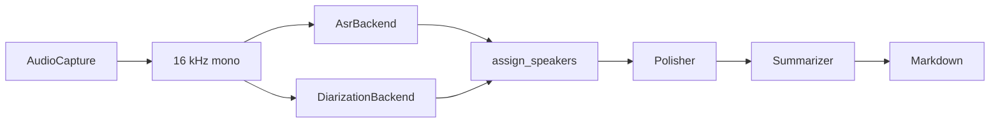

# meetscribe

本地、可換後端的會議逐字稿與摘要工具。第一階段是 CLI：把麥克風與系統音訊分成兩條軌，在本機做語音辨識與說話者切分，再透過任何 OpenAI 相容的端點把逐字稿修成繁體中文並寫出 Markdown。核心是函式庫，之後的 Qt、GTK 或 Electron 介面不用改 pipeline。

meetscribe records a meeting as separate microphone and system tracks, transcribes it locally, assigns speakers, and writes one Markdown note. Polishing and summarization go through any OpenAI-compatible endpoint. The CLI is a thin shell over `meetscribe.pipeline`, which accepts an in-process event sink so a future GUI can subscribe without parsing stdout.

## What runs today

| Piece | Status |
| --- | --- |
| `FileInput`, 16 kHz mono resample, Markdown note, JSON sidecar, `--json-events` | Implemented |
| `faster-whisper` CPU ASR | Implemented, extra `faster-whisper` |
| `mlx-whisper` on Apple Silicon, including word timestamps | Implemented, extra `mlx` |
| Vulkan `whisper.cpp` (`whisper-cli` or pywhispercpp) | Implemented, extra `vulkan` |
| OpenVINO GenAI `WhisperPipeline` with GPU-or-CPU device selection | Implemented, extra `openvino` |
| `track` / `single-speaker` diarization | Implemented, no extra |
| pyannote `speaker-diarization-community-1` on the system track | Implemented, extra `diarization`, needs `HF_TOKEN` |
| Live mic + system recording (macOS, Windows, Linux) and `--live` chunk transcripts | Implemented |
| sherpa-onnx diarization | Stub |
| OpenAI-compatible polish and summary, or an offline fallback when no API key is set | Implemented |

`meetscribe backends` prints `usable=yes` only when this machine can actually run that backend. Weights are not downloaded by the test suite, and the tests do not open a microphone. `examples/sample_meeting.md` is rendered from hand-written utterances. The checklist at the end is the hardware pass for MLX, Vulkan, OpenVINO, and live recording.

## Install

Python 3.11 or newer.

```bash
uv sync
uv run meetscribe --help
uv run meetscribe backends
uv run pytest
```

CPU transcription:

```bash
uv sync --extra faster-whisper
uv run meetscribe backends
```

Other extras, installed on the machine that will actually run them:

| Extra | Install | Used by |
| --- | --- | --- |
| `mlx` | `uv sync --extra mlx` (marker: macOS arm64 only) | MLX ASR |
| `vulkan` or `whisper-cpp` | `uv sync --extra vulkan`; the PyPI wheel is CPU-only | whisper.cpp |
| `openvino` | `uv sync --extra openvino` (marker: Linux and Windows) | OpenVINO ASR |
| `diarization` | `uv sync --extra diarization` | pyannote |
| `capture-linux` | `uv sync --extra capture-linux` | Pulse/PipeWire recording |
| `capture-windows` | `uv sync --extra capture-windows` (marker: Windows) | WASAPI loopback |
| `capture-macos` | `uv sync --extra capture-macos` (marker: macOS) plus the Swift helper | ScreenCaptureKit + mic |
| `audio` | `uv sync --extra audio` | FLAC, OGG, float WAV |
| dev group | `uv sync` installs it | pytest |
| `sherpa` | `uv sync --extra sherpa` | still a stub |

m4a and mp3 need ffmpeg. Convert first, then point the CLI at the wav:

```bash
ffmpeg -i meeting.m4a -ac 1 -ar 16000 meeting.wav
```

## Commands

```bash
meetscribe --help
meetscribe backends
meetscribe transcribe mic.wav --system system.wav --title "支付週會" -o notes/weekly.md
meetscribe summarize notes/weekly.json
meetscribe run mic.wav --system system.wav --speaker Me=林可安 --speaker Remote=客戶
meetscribe devices
meetscribe record --output-dir ./recording --duration 60
meetscribe record --live --chunk-seconds 5 --output-dir ./recording
meetscribe run --live --duration 120 --title "支付週會" -o notes/weekly.md
meetscribe --json-events run mic.wav -o notes/weekly.md
```

`transcribe` writes the transcript and skips the summary. `summarize` reads the JSON sidecar and rewrites the Markdown. `run` does both. `record` captures until Ctrl+C, or until `--duration` seconds. `--live` prints partial segments while the take is running; the finished wavs are still what diarization and the Markdown note use.

Recording writes `mic.wav`, `system.wav`, and `session.json`. The JSON counts silence inserted and samples dropped while the two device clocks were pulled onto `time.monotonic()`. Both files are padded to the same length. Capture is 48 kHz; the pipeline resamples to 16 kHz before ASR.

Speaker ids stay anonymous until you map them. The track diarizer uses the role ids `Me` and `Remote`. A single mixed file uses `SPEAKER_00`. Pass `--speaker SPEAKER_00=陳怡君` or put the same pairs under `[speakers]` in the config file.

With `--json-events`, progress is one JSON object per line on stdout. Human text goes to stderr. A future GUI can spawn the CLI or, better, call `run_meeting` and pass its own sink.

```json
{"event":"stage","stage":"asr","status":"start","track_id":"mic","message":"Transcribing mic"}
{"event":"stage","stage":"asr","status":"done","track_id":"mic","message":"mic: 12 segment(s)","data":{"segments":12}}
{"event":"stage","stage":"polish","status":"start","message":"Polishing with gemma-4-12b-it at http://127.0.0.1:8080/v1"}
{"event":"error","stage":"pipeline","status":"error","message":"..."}
```

Top-level keys are `event`, `stage`, `status`, `track_id`, `message`, `progress`, and `data`.

## Architecture



Timestamps are seconds from the start of the take. Mic and system audio share that timebase. `assign_speakers` gives each ASR segment the diarization turn with the greatest overlap. A turn that names a track only matches that track, so microphone speech is not labeled as the remote party. Ties keep the earlier turn. No overlap becomes `UNKNOWN`. The utterance is marked overlapping when the chosen turn says so, or when another speaker covers at least 30% of the segment.

The Markdown template groups consecutive lines from the same speaker when the gap is at most one second. Sections, in order: title, time, participants, summary (key points, decisions, action items), then the polished transcript.

```
src/meetscribe/
  cli.py            Typer commands
  pipeline.py       capture -> note, no UI imports
  config.py         TOML, env, CLI overrides
  registry.py       backend factories
  hardware.py       Apple Silicon / Intel iGPU defaults
  merge.py          speaker assignment
  document.py       JSON sidecar
  audio/            capture, host-clock sync, platform recorders
  asr/              faster-whisper, mlx, vulkan, openvino
  diarization/      track, single-speaker, pyannote; sherpa is still a stub
  llm/              OpenAI-compatible polish and summary
  render/           Jinja2 template
```

## Defaults per platform

`meetscribe backends` prints the detected hardware and the backend that `auto` will select.

| Machine | Capture | Default ASR | Checkpoint |
| --- | --- | --- | --- |
| Apple Silicon | `macos` | `mlx-whisper` | `schsu/breeze-asr-25-mlx`, fallback `mlx-community/whisper-large-v3-turbo` |
| Windows or Linux with an Intel iGPU | `windows` or `linux` | `openvino` | IR under `~/.cache/meetscribe/models/`. `vulkan` is the other GPU path |
| Anything else | the platform recorder, or `file` | `faster-whisper` | CTranslate2 large-v3-turbo, because Breeze is not a CT2 checkpoint |

Diarization `auto` uses `track` when both mic and system audio are present, and `single-speaker` for one mixed file. `--diarization pyannote` keeps the mic as `Me` and splits remote speakers on `system.wav`.

Breeze-ASR-25 is a Transformers Whisper checkpoint. faster-whisper substitutes large-v3-turbo and says so. MLX uses a published conversion. GGML and OpenVINO need the scripts below.

## Model conversion

MLX, on Apple Silicon. The default repo is already converted, so this is only for a local rebuild:

```bash
uv run python scripts/convert_mlx.py
git clone https://github.com/ml-explore/mlx-examples.git
uv run python scripts/convert_mlx.py --convert \
  --convert-script mlx-examples/whisper/convert.py \
  --torch-name-or-path MediaTek-Research/Breeze-ASR-25 \
  --mlx-path ~/.cache/meetscribe/models/breeze-asr-25-mlx
```

The converter sometimes writes `model.safetensors`. mlx-whisper loads `weights.safetensors`. The script renames it. Known public weights: `schsu/breeze-asr-25-mlx` and `mlx-community/whisper-large-v3-turbo`.

GGML / Vulkan:

```bash
python scripts/convert_ggml.py
# large-v3-turbo without a conversion: download ggml-large-v3-turbo.bin from
# https://huggingface.co/ggerganov/whisper.cpp into ~/.cache/meetscribe/models/
git clone https://github.com/ggml-org/whisper.cpp.git
uv run --with huggingface_hub --with torch --with transformers python scripts/convert_ggml.py --convert --whisper-cpp whisper.cpp
cmake -B whisper.cpp/build -S whisper.cpp -DGGML_VULKAN=1
cmake --build whisper.cpp/build --target whisper-cli -j
export MEETSCRIBE_WHISPER_CPP="$PWD/whisper.cpp/build/bin/whisper-cli"
```

A Vulkan-enabled Python binding, instead of the CLI:

```bash
GGML_VULKAN=1 uv pip install --no-binary pywhispercpp pywhispercpp
```

The stock pywhispercpp wheel is CPU. `meetscribe backends` says whether a Vulkan ICD was found. `whisper-cli` wins over pywhispercpp when `MEETSCRIBE_WHISPER_CPP` or `whisper-cli` is on `PATH`.

OpenVINO:

```bash
uv sync --extra openvino
uv run --with "optimum-intel[openvino]" python scripts/export_openvino.py --convert
uv run --with "optimum-intel[openvino]" python scripts/export_openvino.py --model openai/whisper-large-v3-turbo --convert
uv run meetscribe transcribe meeting.wav --asr-backend openvino
```

`auto` picks `GPU` when OpenVINO lists one, otherwise CPU. Override with `MEETSCRIBE_OPENVINO_DEVICE=CPU` or `[asr] openvino_device`.

## Recording

Linux needs PipeWire or PulseAudio (`pactl`) and sounddevice. System audio is the sink `.monitor` source.

```bash
uv sync --extra capture-linux
uv run meetscribe devices
uv run meetscribe record -o ./recording --mic-device alsa_input --system-device monitor
```

Windows uses WASAPI loopback from PyAudioWPatch, so the meeting audio is the render endpoint and the headset is a separate capture endpoint.

```bash
uv sync --extra capture-windows
uv run meetscribe devices
uv run meetscribe record -o .\recording
```

macOS uses sounddevice for the microphone and a Swift ScreenCaptureKit helper for system audio. PyObjC's completion-handler wrapping of ScreenCaptureKit is brittle across OS releases, and the process that calls it needs Screen Recording permission. A tiny helper keeps that permission on one binary and writes 48 kHz s16le PCM to stdout. Python stamps each read with `time.monotonic()`, the same clock as the mic callback, and the sync session absorbs the few milliseconds of pipe delay the same way it absorbs device drift.

```bash
uv sync --extra capture-macos
swiftc -O -o ~/.local/bin/meetscribe-system-audio scripts/macos/SystemAudioCapture.swift
# System Settings → Privacy & Security → Screen Recording → allow the terminal
uv run meetscribe record -o ./recording
```

`session.json` next to the wavs reports silence inserted and samples dropped per track.

## Manual test checklist

Run `meetscribe backends` first and confirm `usable=yes` for the backend you are about to try.

Apple Silicon

1. `uv sync --extra mlx --extra capture-macos`, compile the Swift helper, allow Screen Recording.
2. `uv run meetscribe backends` shows `mlx-whisper` usable and `macos` usable.
3. Play a Traditional Chinese / English clip. `meetscribe record -o /tmp/take --duration 20`.
4. Confirm `mic.wav` and `system.wav` are both non-silent, similar length, and `session.json` has small silence/dropped times.
5. `meetscribe transcribe /tmp/take --asr-backend mlx-whisper --diarization pyannote`. The note is Traditional Chinese, English product names stay in English, and remote speakers are not all labeled `Me`.
6. `meetscribe record --live --chunk-seconds 5 --duration 30` prints segments before the process exits.

Windows, Intel iGPU

1. `uv sync --extra openvino --extra capture-windows` and export an IR with `scripts/export_openvino.py --convert`.
2. Build `whisper-cli` with `-DGGML_VULKAN=1` and set `MEETSCRIBE_WHISPER_CPP`.
3. `meetscribe backends` shows `openvino` usable with a GPU device, and `vulkan` usable with an ICD.
4. Join a browser meeting. `meetscribe record -o .\take --duration 30`. Mic and system wavs differ.
5. Transcribe the same take with `--asr-backend openvino` and again with `--asr-backend vulkan`.
6. `meetscribe transcribe .\take --diarization pyannote` after `HF_TOKEN` is set and the community-1 conditions are accepted.

Linux, Intel iGPU or any Vulkan GPU

1. `uv sync --extra capture-linux --extra openvino --extra vulkan`. Export IR. Build Vulkan `whisper-cli`.
2. `meetscribe devices` lists a `.monitor` source and a mic.
3. `meetscribe record -o /tmp/take --duration 15` while audio plays through the speakers. `system.wav` follows that playback; `mic.wav` follows the microphone.
4. `meetscribe transcribe /tmp/take --asr-backend openvino` and `--asr-backend vulkan`.
5. `meetscribe record --live --duration 20` emits `[mic …]` / `[system …]` lines and still writes the wavs.

If a GPU device is missing, OpenVINO logs a CPU fallback and still returns text. Vulkan without an ICD runs only when the binary or the pywhispercpp wheel is a CPU build; `backends` says which case it detected.

Meetings are assumed to be Taiwan Mandarin mixed with English. The ASR language hint defaults to `zh`. Whisper often emits Simplified Chinese; the polisher rewrites that to zh-TW and leaves API names, product names, identifiers, and abbreviations in English.

## Config

Path resolution:

1. `--config PATH` if you passed one
2. `$MEETSCRIBE_CONFIG`
3. `$XDG_CONFIG_HOME/meetscribe/config.toml`, or `~/.config/meetscribe/config.toml`

A missing default file is fine. A path you named yourself must exist. Copy `examples/config.example.toml` as a starting point.

Precedence is defaults, then TOML, then `MEETSCRIBE_ASR_BACKEND`, `MEETSCRIBE_ASR_MODEL`, `MEETSCRIBE_DIARIZATION`, `MEETSCRIBE_LLM_MODEL`, and `OPENAI_BASE_URL`, then CLI flags.

Secrets are read from the environment at call time. `api_key` and `hf_token` in the TOML file are rejected. The variable name is configurable:

```toml
[llm]
base_url = "http://127.0.0.1:8080/v1"
api_key_env = "OPENAI_API_KEY"
model = "gemma-4-12b-it"
fallback_model = "qwen3.5-9b"
polish = true
context_tokens = 16384
reserve_tokens = 2048
# temperature = 0.2   # set under [llm] to override the matched profile

[llm.profiles."gemma-4-12b-it"]
temperature = 1.0
top_p = 0.95
top_k = 64
min_p = 0.0

[llm.profiles."qwen3.5-9b"]
temperature = 0.7
top_p = 0.8
top_k = 20
min_p = 0.0
presence_penalty = 1.5

[diarization]
hf_token_env = "HF_TOKEN"
```

`OPENAI_BASE_URL` still overrides `base_url` when you point at another OpenAI-compatible server (LM Studio, vLLM, or `https://api.openai.com/v1`). Set `OPENAI_API_KEY` for those servers. llama-server does not check a key; when the variable is unset the client sends the dummy value `llama-server`. In single-model mode llama-server also ignores the `model` field. `context_tokens` should be less than or equal to the server's `-c`. Transcripts that would exceed that budget, minus `reserve_tokens` and the system prompt, are polished and summarized in chunks, then the partial summaries are merged. Sampling comes from `[llm.profiles."<model>"]`. meetscribe asks `GET /v1/models` and uses the loaded alias when the server answers; otherwise it uses `model`. `--llm-model` skips that lookup. A sampling key written directly under `[llm]` replaces that one field from the profile.

`transcribe` still skips the summary stage. Prompts ask for JSON, Traditional Chinese, and English technical terms kept in English. They live in `src/meetscribe/llm/prompts.py`.

## llama-server

The default local model is **Gemma 4 12B** (instruct). When the machine cannot hold that GGUF plus the KV cache, switch the server to **Qwen 3.5 9B**. meetscribe does not swap models by itself: start `llama-server` with the file that fits, and keep `[llm].context_tokens` equal to `-c`.

Confirmed Unsloth GGUF repos (file pages and model cards, not guessed):

| Role | Repo | Quant | File | Size |
| --- | --- | --- | --- | --- |
| Default | [`unsloth/gemma-4-12b-it-GGUF`](https://huggingface.co/unsloth/gemma-4-12b-it-GGUF) | `UD-Q4_K_XL` | `gemma-4-12b-it-UD-Q4_K_XL.gguf` | **7.37 GB** |
| Fallback | [`unsloth/Qwen3.5-9B-GGUF`](https://huggingface.co/unsloth/Qwen3.5-9B-GGUF) | `UD-Q4_K_XL` | `Qwen3.5-9B-UD-Q4_K_XL.gguf` | **5.97 GB** |

The repo id is `unsloth/gemma-4-12b-it-GGUF` (lowercase `12b`). Unsloth also publishes a separate QAT repo, `unsloth/gemma-4-12B-it-qat-GGUF`. The commands below use the instruct dynamic quant, which is the one the Gemma card's llama.cpp example loads. Native context is 256K for Gemma 4 12B (`google/gemma-4-12B`) and 262,144 for Qwen3.5-9B (`Qwen/Qwen3.5-9B`). `16384` stays the meetscribe default so the KV cache can sit beside a 4-bit 12B on an iGPU. Unsloth's own Gemma server snippet uses `-c 8192`; raise `-c` and `context_tokens` together if you have the memory.

Sampling profiles match the cards. Gemma 4 (also in the GGUF `general.sampling` metadata): temperature **1.0**, top_p **0.95**, top_k **64**. The card does not set `min_p`. Qwen3.5 non-thinking general tasks: temperature **0.7**, top_p **0.8**, top_k **20**, min_p **0.0**, presence_penalty **1.5**. `meetscribe backends` prints the model it will use and which profile matched. Thinking stays off for JSON notes.

Gemma's Unsloth card says `-hf` downloads the mmproj automatically. Pass `--no-mmproj` for text-only meeting notes, or `--mmproj-url` ending in `mmproj-F16.gguf` to pin the projector. Qwen's Unsloth guide keeps vision in a separate `mmproj-F16.gguf` and does not pass it for text. Both cards want `--jinja`. Disable thinking with `--chat-template-kwargs '{"enable_thinking":false}'` and `--reasoning off`. The client still strips leftover `<think>` and `<|channel>thought` text.

CPU, Gemma 4 12B:

```bash
cmake -B build
cmake --build build --config Release -j
./build/bin/llama-server \
  -hf unsloth/gemma-4-12b-it-GGUF:UD-Q4_K_XL \
  --no-mmproj --jinja \
  --chat-template-kwargs '{"enable_thinking":false}' \
  --reasoning off \
  --temp 1.0 --top-p 0.95 --top-k 64 \
  -c 16384 --host 127.0.0.1 --port 8080 \
  --alias gemma-4-12b-it
```

Metal (Apple Silicon). `GGML_METAL` is on by default in macOS builds; the flag is explicit here:

```bash
cmake -B build -DGGML_METAL=ON
cmake --build build --config Release -j
./build/bin/llama-server \
  -hf unsloth/gemma-4-12b-it-GGUF:UD-Q4_K_XL \
  --no-mmproj --jinja \
  --chat-template-kwargs '{"enable_thinking":false}' \
  --reasoning off \
  --temp 1.0 --top-p 0.95 --top-k 64 \
  -c 16384 -ngl 99 --host 127.0.0.1 --port 8080 \
  --alias gemma-4-12b-it
```

Vulkan (Windows or Linux, including Intel iGPUs):

```bash
cmake -B build -DGGML_VULKAN=ON
cmake --build build --config Release -j
./build/bin/llama-server \
  -hf unsloth/gemma-4-12b-it-GGUF:UD-Q4_K_XL \
  --no-mmproj --jinja \
  --chat-template-kwargs '{"enable_thinking":false}' \
  --reasoning off \
  --temp 1.0 --top-p 0.95 --top-k 64 \
  -c 16384 -ngl 99 --host 127.0.0.1 --port 8080 \
  --alias gemma-4-12b-it
```

SYCL (Intel iGPU via oneAPI):

```bash
source /opt/intel/oneapi/setvars.sh
cmake -B build -DGGML_SYCL=ON -DCMAKE_C_COMPILER=icx -DCMAKE_CXX_COMPILER=icpx
cmake --build build --config Release -j
./build/bin/llama-server \
  -hf unsloth/gemma-4-12b-it-GGUF:UD-Q4_K_XL \
  --no-mmproj --jinja \
  --chat-template-kwargs '{"enable_thinking":false}' \
  --reasoning off \
  --temp 1.0 --top-p 0.95 --top-k 64 \
  -c 16384 -ngl 99 --host 127.0.0.1 --port 8080 \
  --alias gemma-4-12b-it
```

Fallback when the 7.37 GB Gemma quant does not fit. The Qwen profile is selected from the server alias, so you do not have to copy the numbers into `[llm]`. Text-only: do not pass Qwen's `mmproj-F16.gguf`.

```bash
./build/bin/llama-server \
  -hf unsloth/Qwen3.5-9B-GGUF:UD-Q4_K_XL \
  --jinja \
  --chat-template-kwargs '{"enable_thinking":false}' \
  --reasoning off \
  --temp 0.7 --top-p 0.8 --top-k 20 --min-p 0.0 \
  -c 16384 -ngl 99 --host 127.0.0.1 --port 8080 \
  --alias qwen3.5-9b
```

Set `[llm].model` to the alias you started. A single-model server still answers if the name does not match. Then `uv run meetscribe run meeting.wav`. The client calls `http://127.0.0.1:8080/v1/chat/completions`.

## Add a backend

1. Implement the protocol in `audio/base.py`, `asr/base.py`, or `diarization/base.py`.
2. Declare capabilities. ASR reports `streaming`, `word_timestamps`, and `device` (`cpu`, `metal`, `openvino-gpu`, …). Diarization reports overlap support and whether a token is required. Capture reports mic, system audio, and separate tracks.
3. Import optional libraries inside the method that needs them, and raise `BackendNotInstalled` with the extra name.
4. Register a `BackendSpec` in `build_registry()`. `auto` selection lives in `hardware.py` (`recommended_asr`, `recommended_capture`, `recommended_diarization`).

```python
class MyAsr:
    name = "my-asr"

    def capabilities(self) -> AsrCapabilities:
        return AsrCapabilities(streaming=False, word_timestamps=True, device="cpu")

    def transcribe(self, audio, *, track_id, language=None, on_event=None):
        ...
        return [TranscriptSegment(text="...", start=0.0, end=1.0, track_id=track_id)]
```

Return segments on the capture timebase. A diarizer returns `SpeakerTurn` values. Set `track_id` when the speaker is known to belong to mic or system audio; leave it `None` when the turn may match either track.

A GUI should call `run_meeting` or `summarize_file` with an object that implements `emit(ProgressEvent)`. It should not import `cli.py`.

## Development

```bash
uv sync
uv run pytest
uv run python examples/sample_meeting.py
```

`uv run pytest` covers speaker assignment, Markdown rendering, config precedence, the registry (including a fake backend), WAV normalization, the LLM JSON parsers, and an end-to-end run with fake ASR and summarizer.

The checked-in note is `examples/sample_meeting.md`.
