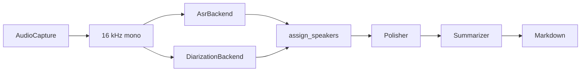

# meetscribe

本地、可換後端的會議逐字稿與摘要工具。第一階段是 CLI：把麥克風與系統音訊分成兩條軌，在本機做語音辨識與說話者切分，再透過任何 OpenAI 相容的端點把逐字稿修成繁體中文並寫出 Markdown。核心是函式庫，之後的 Qt、GTK 或 Electron 介面不用改 pipeline。

meetscribe records a meeting as separate microphone and system tracks, transcribes it locally, assigns speakers, and writes one Markdown note. Polishing and summarization go through any OpenAI-compatible endpoint. The CLI is a thin shell over `meetscribe.pipeline`, which accepts an in-process event sink so a future GUI can subscribe without parsing stdout.

## What runs today

| Piece | Status |
| --- | --- |
| `FileInput` (existing wav files, or a directory with `mic.wav` / `system.wav`) | Implemented |
| Resample to 16 kHz mono PCM | Implemented |
| `faster-whisper` ASR | Implemented, optional extra `faster-whisper` |
| `mlx-whisper`, OpenVINO GenAI, whisper.cpp | Stubs with lazy imports |
| `track` diarizer (mic = `Me`, system = `Remote`) and `single-speaker` | Implemented |
| pyannote.audio 4 / `speaker-diarization-community-1`, sherpa-onnx | Stubs with lazy imports |
| macOS ScreenCaptureKit, Windows WASAPI loopback, Linux PulseAudio/PipeWire | Stubs with lazy imports |
| OpenAI-compatible polisher and summarizer | Implemented |
| Offline identity polish and extractive summary when no API key is set | Implemented |
| Jinja2 Markdown note and JSON sidecar | Implemented |
| `--json-events` JSONL progress stream | Implemented |

ASR and diarization weights are not downloaded by the test suite. The sample note in `examples/sample_meeting.md` is rendered from hand-written utterances.

## Install

Python 3.11 or newer.

```bash
python -m venv .venv
source .venv/bin/activate
pip install -e ".[dev]"
```

CPU transcription:

```bash
pip install -e ".[faster-whisper]"
```

Other extras, installed on the machine that will actually run them:

| Extra | Packages | Used by |
| --- | --- | --- |
| `mlx` | mlx-whisper | Apple Silicon ASR stub (planned runtime) |
| `openvino` | openvino-genai | Intel iGPU ASR stub |
| `whisper-cpp` | pywhispercpp | GGML fallback stub |
| `diarization` | pyannote.audio | pyannote stub |
| `sherpa` | sherpa-onnx | sherpa-onnx stub |
| `audio` | soundfile | FLAC, OGG, and float WAV |
| `dev` | pytest | Tests |

m4a and mp3 need ffmpeg. Convert first, then point the CLI at the wav:

```bash
ffmpeg -i meeting.m4a -ac 1 -ar 16000 meeting.wav
```

## Commands

```bash
meetscribe --help
meetscribe backends
meetscribe transcribe mic.wav --system system.wav --title "支付週會" -o notes/weekly.md
meetscribe summarize notes/weekly.json
meetscribe run mic.wav --system system.wav --speaker Me=林可安 --speaker Remote=客戶
meetscribe record --output-dir ./recording --duration 60
meetscribe --json-events run mic.wav -o notes/weekly.md
```

`transcribe` writes the transcript and skips the summary. `summarize` reads the JSON sidecar and rewrites the Markdown. `run` does both. `record` selects the platform capture backend; those backends are still stubs, so use existing files with `transcribe` or `run`.

Speaker ids stay anonymous until you map them. The track diarizer uses the role ids `Me` and `Remote`. A single mixed file uses `SPEAKER_00`. Pass `--speaker SPEAKER_00=陳怡君` or put the same pairs under `[speakers]` in the config file.

With `--json-events`, progress is one JSON object per line on stdout. Human text goes to stderr. A future GUI can spawn the CLI or, better, call `run_meeting` and pass its own sink.

```json
{"event":"stage","stage":"asr","status":"start","track_id":"mic","message":"Transcribing mic"}
{"event":"stage","stage":"asr","status":"done","track_id":"mic","message":"mic: 12 segment(s)","data":{"segments":12}}
{"event":"log","stage":"summarize","message":"No API key in OPENAI_API_KEY. Writing an extractive summary instead of calling the LLM."}
{"event":"error","stage":"pipeline","status":"error","message":"..."}
```

Top-level keys are `event`, `stage`, `status`, `track_id`, `message`, `progress`, and `data`.

## Architecture



Timestamps are seconds from the start of the take. Mic and system audio share that timebase. `assign_speakers` gives each ASR segment the diarization turn with the greatest overlap. A turn that names a track only matches that track, so microphone speech is not labeled as the remote party. Ties keep the earlier turn. No overlap becomes `UNKNOWN`. The utterance is marked overlapping when the chosen turn says so, or when another speaker covers at least 30% of the segment.

The Markdown template groups consecutive lines from the same speaker when the gap is at most one second. Sections, in order: title, time, participants, summary (key points, decisions, action items), then the polished transcript.

```
src/meetscribe/
  cli.py            Typer commands
  pipeline.py       capture -> note, no UI imports
  config.py         TOML, env, CLI overrides
  registry.py       backend factories
  hardware.py       Apple Silicon / Intel iGPU defaults
  merge.py          speaker assignment
  document.py       JSON sidecar
  audio/            capture protocol, WAV I/O, platform stubs
  asr/              ASR protocol, faster-whisper, stubs
  diarization/      protocol, track, single-speaker, stubs
  llm/              OpenAI-compatible polish and summary
  render/           Jinja2 template
```

## Defaults per platform

`meetscribe backends` prints the detected hardware and the backend that `auto` will select.

| Machine | Capture | ASR | Model the ASR path is aimed at |
| --- | --- | --- | --- |
| Apple Silicon | `macos` (ScreenCaptureKit + Core Audio tap) | `mlx-whisper` | `MediaTek-Research/Breeze-ASR-25`, then `openai/whisper-large-v3-turbo` |
| Windows or Linux with an Intel iGPU | `windows` (WASAPI loopback) or `linux` (PulseAudio/PipeWire monitor) | `openvino` | OpenVINO Whisper IR; Breeze has to be converted before this backend can load it |
| Anything else | platform stub, or `file` for audio you already have | `faster-whisper` | CTranslate2 build of the fallback, `large-v3-turbo` |

Diarization `auto` uses `track` when both mic and system audio are present, and `single-speaker` for one mixed file. `pyannote` will need `HF_TOKEN` and the community-1 pipeline. `sherpa-onnx` is the planned local diarizer with no token.

Breeze-ASR-25 is a Transformers checkpoint, not a CTranslate2 or GGML file. The faster-whisper backend keeps the name in config and substitutes a large-v3-turbo CT2 build, then logs that substitution. Use `mlx-whisper` on Apple Silicon when you want Breeze itself.

Meetings are assumed to be Taiwan Mandarin mixed with English. The ASR language hint defaults to `zh`. Whisper often emits Simplified Chinese; the polisher rewrites that to zh-TW and leaves API names, product names, identifiers, and abbreviations in English.

## Config

Path resolution:

1. `--config PATH` if you passed one
2. `$MEETSCRIBE_CONFIG`
3. `$XDG_CONFIG_HOME/meetscribe/config.toml`, or `~/.config/meetscribe/config.toml`

A missing default file is fine. A path you named yourself must exist. Copy `examples/config.example.toml` as a starting point.

Precedence is defaults, then TOML, then `MEETSCRIBE_ASR_BACKEND`, `MEETSCRIBE_ASR_MODEL`, `MEETSCRIBE_DIARIZATION`, `MEETSCRIBE_LLM_MODEL`, and `OPENAI_BASE_URL`, then CLI flags.

Secrets are read from the environment at call time. `api_key` and `hf_token` in the TOML file are rejected. The variable name is configurable:

```toml
[llm]
base_url = "http://127.0.0.1:11434/v1"
api_key_env = "OPENAI_API_KEY"
model = "qwen2.5:14b"
polish = true

[diarization]
hf_token_env = "HF_TOKEN"
```

```bash
export OPENAI_API_KEY="local"          # Ollama ignores the value but the client requires one
export OPENAI_BASE_URL="http://127.0.0.1:11434/v1"   # optional; overrides the file
```

The same shape works for LM Studio (`http://127.0.0.1:1234/v1`), vLLM, llama.cpp's server, and the public OpenAI API (`https://api.openai.com/v1` plus a real key). The client is the official `openai` package:

```python
OpenAI(base_url=config.llm.base_url, api_key=api_key).chat.completions.create(...)
```

Without a key, polish copies ASR text through and summarize writes a short extractive overview marked `（未呼叫 LLM…）`. `transcribe` always skips the summary stage.

Prompts ask for JSON, Traditional Chinese, and English technical terms kept in English. They live in `src/meetscribe/llm/prompts.py`.

## Add a backend

1. Implement the protocol in `audio/base.py`, `asr/base.py`, or `diarization/base.py`.
2. Declare capabilities. ASR reports `streaming`, `word_timestamps`, and `device` (`cpu`, `metal`, `openvino-gpu`, …). Diarization reports overlap support and whether a token is required. Capture reports mic, system audio, and separate tracks.
3. Import optional libraries inside the method that needs them, and raise `BackendNotInstalled` with the extra name.
4. Register a `BackendSpec` in `build_registry()`. `auto` selection lives in `hardware.py` (`recommended_asr`, `recommended_capture`, `recommended_diarization`).

```python
class MyAsr:
    name = "my-asr"

    def capabilities(self) -> AsrCapabilities:
        return AsrCapabilities(streaming=False, word_timestamps=True, device="cpu")

    def transcribe(self, audio, *, track_id, language=None, on_event=None):
        ...
        return [TranscriptSegment(text="...", start=0.0, end=1.0, track_id=track_id)]
```

Return segments on the capture timebase. A diarizer returns `SpeakerTurn` values. Set `track_id` when the speaker is known to belong to mic or system audio; leave it `None` when the turn may match either track.

A GUI should call `run_meeting` or `summarize_file` with an object that implements `emit(ProgressEvent)`. It should not import `cli.py`.

## Development

```bash
pip install -e ".[dev]"
pytest
PYTHONPATH=src python examples/sample_meeting.py
```

`pytest` covers speaker assignment, Markdown rendering, config precedence, the registry (including a fake backend), WAV normalization, the LLM JSON parsers, and an end-to-end run with fake ASR and summarizer.

The checked-in note is `examples/sample_meeting.md`.
